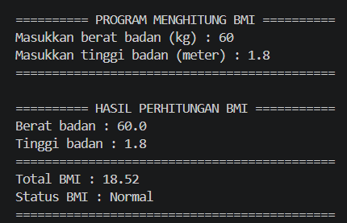

### :abacus: PROGRAM PENGHITUNG *BODY MASS INDEX* (BMI) :snake:

---
***Body Mass Index* (BMI)** atau dalam bahasa indonesia yaitu **Indeks Massa Tubuh (IMT)** adalah alat skrining kesehatan sederhana yang digunakan untuk menilai status berat badan seseorang berdasarkan perbandingan antara berat badan (kg) dan tinggi badan (m).

### :gear: Cara Menjalankan Program
Pastikan komputer Anda sudah terinstal Python 3.8 atau yang lebih baru (dikembangkan menggunakan Python 3.12). Untuk menjalankan program ini, silahkan ikuti panduan berikut ini:

1. **Unduh kode program:**
```bash
git clone https://github.com/ardipuji/kalkulator-bmi.git
```

2. **Masuk ke folder proyek:**
```bash
cd kalkulator-bmi
```

3. **Jalankan program:**
```bash
python kalkulator_bmi.py
```
atau
```bash
py kalkulator_bmi.py
```

### :camera_flash: Preview

Tampilan halaman input dan output yang dihasilkan.



## :man_technologist: Author

Dikembangkan oleh **Ardi**

- :email: **Email:** [hardipuji19@email.com](mailto:hardipuji19@email.com)
- :link: **GitHub:** [@ardipuji](https://github.com/ardipuji)

---
*Terbuka untuk saran, masukan, maupun peluang kolaborasi!*
